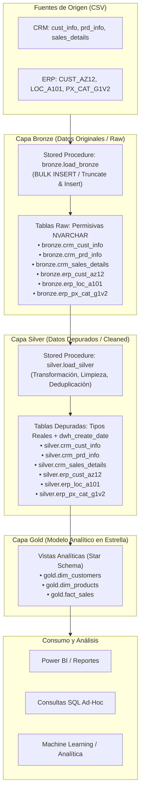
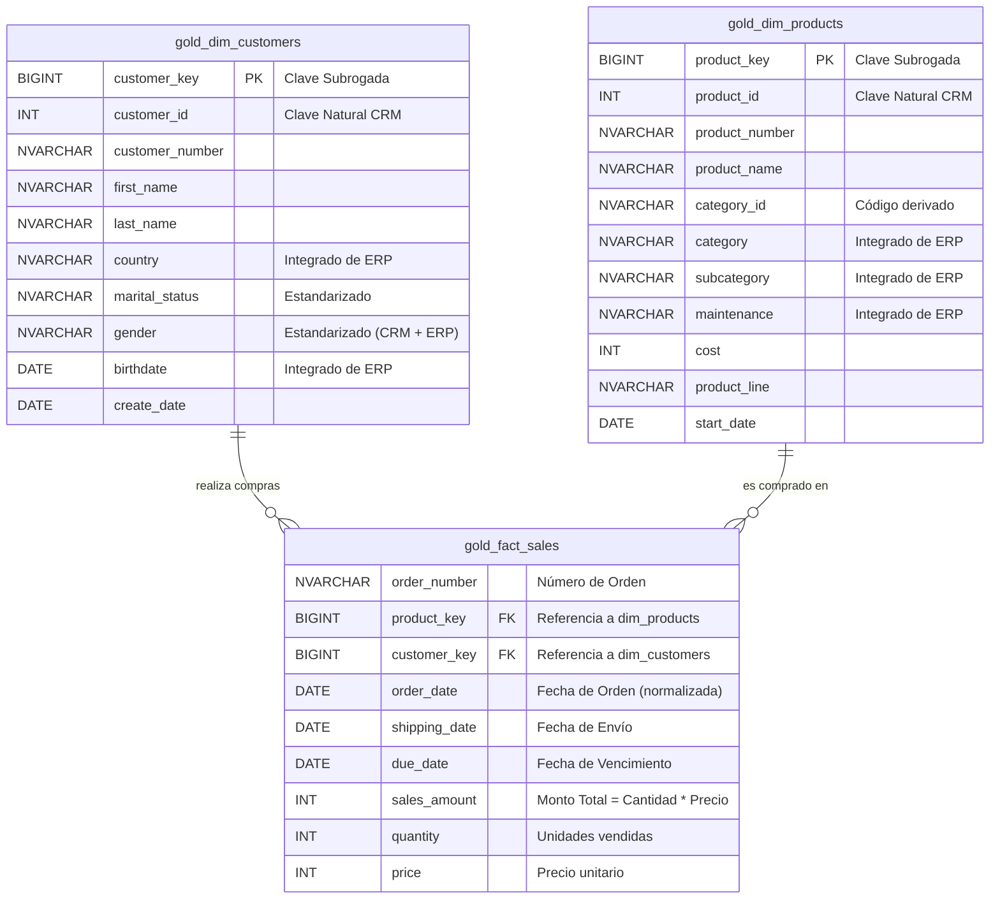

# **Documentación del Almacén de Datos (Data Warehouse)**
## **Arquitectura Medallion en SQL Server**

---

## **1. Resumen Ejecutivo del Proyecto**
Este Data Warehouse consolida la información transaccional de ventas y clientes proveniente de dos sistemas heterogéneos:
* **CRM (Customer Relationship Management):** Ventas transaccionales, productos y clientes.
* **ERP (Enterprise Resource Planning):** Demografía de clientes (país, fecha de nacimiento) y categorización de productos.

Se implementa bajo la **Arquitectura Medallion (Bronze, Silver, Gold)** en Microsoft SQL Server para garantizar trazabilidad, calidad de datos y un modelo dimensional optimizado para Business Intelligence (Power BI) y consultas analíticas.

---

## **2. Flujo de Datos y Arquitectura Medallion**

---

## **3. Modelo Dimensional en Estrella (Star Schema - Gold)**

---

## **4. Catálogo y Diccionario de Datos (Capa Gold)**

### **4.1. Vista `gold.dim_customers`**
| Columna | Tipo de Dato | Rol | Descripción / Regla de Negocio |
| :--- | :--- | :--- | :--- |
| `customer_key` | `BIGINT` | Clave Primaria (Surrogate) | Clave única generada mediante `ROW_NUMBER()`. |
| `customer_id` | `INT` | Clave de Negocio | Identificador original del cliente en CRM. |
| `customer_number` | `NVARCHAR(50)` | Atributo | Código de cliente (ej. AW00011000). |
| `first_name` | `NVARCHAR(50)` | Atributo | Nombre del cliente sin espacios residuales (`TRIM`). |
| `last_name` | `NVARCHAR(50)` | Atributo | Apellido del cliente sin espacios residuales (`TRIM`). |
| `country` | `NVARCHAR(50)` | Atributo | País de residencia normalizado (desde `LOC_A101`). |
| `marital_status` | `NVARCHAR(50)` | Atributo | Estado civil: `Married`, `Single` o `n/a`. |
| `gender` | `NVARCHAR(50)` | Atributo | Género consolidado (`Male`, `Female` o `n/a`). Prioridad CRM sobre ERP. |
| `birthdate` | `DATE` | Atributo | Fecha de nacimiento validada (desde `CUST_AZ12`). |
| `create_date` | `DATE` | Atributo | Fecha de alta del cliente en el sistema CRM. |

### **4.2. Vista `gold.dim_products`**
| Columna | Tipo de Dato | Rol | Descripción / Regla de Negocio |
| :--- | :--- | :--- | :--- |
| `product_key` | `BIGINT` | Clave Primaria (Surrogate) | Clave única generada mediante `ROW_NUMBER()`. |
| `product_id` | `INT` | Clave de Negocio | Identificador original del producto en CRM. |
| `product_number` | `NVARCHAR(50)` | Atributo | Código del producto (sin el prefijo de categoría). |
| `product_name` | `NVARCHAR(50)` | Atributo | Nombre oficial del producto. |
| `category_id` | `NVARCHAR(50)` | Atributo | Código de categoría para vinculación con ERP (`cat_id`). |
| `category` | `NVARCHAR(50)` | Atributo | Nombre de la categoría (ej. Accessories, Bikes). |
| `subcategory` | `NVARCHAR(50)` | Atributo | Subcategoría de producto (ej. Helmets, Mountain Bikes). |
| `maintenance` | `NVARCHAR(50)` | Atributo | Indicador de mantenimiento (`Yes` / `No`). |
| `cost` | `INT` | Métrica | Costo base del producto. |
| `product_line` | `NVARCHAR(50)` | Atributo | Línea comercial: `Road`, `Mountain`, `Touring`, `Other Sales`. |
| `start_date` | `DATE` | Atributo | Fecha de inicio de vigencia del producto. |

### **4.3. Vista `gold.fact_sales`**
| Columna | Tipo de Dato | Rol | Descripción / Regla de Negocio |
| :--- | :--- | :--- | :--- |
| `order_number` | `NVARCHAR(50)` | Atributo Transaccional | Número único del pedido / factura. |
| `product_key` | `BIGINT` | Clave Foránea | Enlace a `gold.dim_products`. |
| `customer_key` | `BIGINT` | Clave Foránea | Enlace a `gold.dim_customers`. |
| `order_date` | `DATE` | Dimensión Temporal | Fecha en la que se generó la orden (fechas `0` convertidas a `NULL`). |
| `shipping_date` | `DATE` | Dimensión Temporal | Fecha en la que se despachó el pedido. |
| `due_date` | `DATE` | Dimensión Temporal | Fecha estimada de entrega / vencimiento. |
| `sales_amount` | `INT` | Métrica Aditiva | Monto facturado. Corregido como `quantity * price` si presentaba inconsistencias. |
| `quantity` | `INT` | Métrica Aditiva | Unidades vendidas. |
| `price` | `INT` | Métrica | Precio unitario facturado. |

---

## **5. Análisis de Sistemas de Origen (Contexto de Negocio)**

* **Propiedad de los Datos:**
  * CRM: Administrado por el área comercial y servicio al cliente. Registra órdenes transaccionales en tiempo real.
  * ERP: Administrado por operaciones y finanzas. Mantiene datos maestros fiscales, logísticos y de categorización.
* **Integración y Carga:**
  * Modo de Carga: Carga Completa (*Full Load - Truncate & Insert*) por lotes.
  * Alcance (*Scope*): Conjunto más reciente. No se requiere historial de cambios (SCD).
  * Tolerancia a fallos: La capa Bronze absorbe archivos en bruto sin tipado restrictivo para no interrumpir el pipeline.