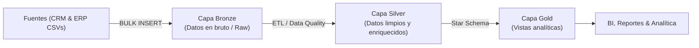

#  Data Warehouse con Arquitectura Medallion (SQL Server)

Proyecto de Ingeniería de Datos para la construcción de un Almacén de Datos moderno utilizando **Microsoft SQL Server**, aplicando la **Arquitectura Medallion (Bronze, Silver, Gold)** y modelado dimensional en estrella (**Star Schema**).

---

##  Objetivo del Proyecto
Consolidar e integrar datos transaccionales de ventas, productos y clientes provenientes de dos fuentes desalineadas (**CRM** y **ERP**) suministradas en archivos CSV, resolviendo problemas de calidad de datos y proporcionando vistas analíticas listas para consumo en herramientas de Business Intelligence (Power BI) y consultas analíticas.

---

##  Arquitectura de Datos (Medallion Architecture)



* ** Capa Bronze:** Ingesta de datos sin procesar (*Raw*) en tablas permisivas (`NVARCHAR`) mediante `BULK INSERT` y el procedimiento `bronze.load_bronze` (estrategia *Truncate & Insert*).
* ** Capa Silver:** Limpieza, tipificación de datos (`INT`, `DATE`), normalización de género y país, deduplicación de clientes y auditoría con `dwh_create_date` mediante `silver.load_silver`.
* ** Capa Gold:** Modelo dimensional en estrella (*Star Schema*) compuesto por vistas analíticas (`dim_customers`, `dim_products`, `fact_sales`) con claves subrogadas (`_key`).

---

##  Estructura del Repositorio

```text
sql-data-warehouse-project/
├── 00_setup/
│   └── setup_guide.md                  # Guía paso a paso para levantar el proyecto desde cero
├── 01_datasets/
│   ├── source_crm/                     # Archivos fuente: cust_info, prd_info, sales_details
│   └── source_erp/                     # Archivos fuente: CUST_AZ12, LOC_A101, PX_CAT_G1V2
├── 02_docs/
│   ├── data_model_and_catalog.md       # Diagramas ER, flujo de datos y diccionario de datos
│   ├── convenciones_nomenclatura_es.md # Estándar oficial de nombres y convenciones
│   └── project_roadmap.puml            # Mapa mental del proyecto
├── 03_scripts/
│   ├── init_database.sql               # Inicialización de la BD y esquemas (bronze, silver, gold)
│   ├── bronze/
│   │   ├── ddl_bronze.sql              # DDL de tablas en bruto
│   │   └── proc_load_bronze.sql        # Stored Procedure de ingesta masiva
│   ├── silver/
│   │   ├── ddl_silver.sql              # DDL de tablas depuradas con tipos de datos reales
│   │   └── proc_load_silver.sql        # Stored Procedure de limpieza y transformación
│   └── gold/
│       └── ddl_gold.sql                # Definición de vistas analíticas (Star Schema)
└── 04_tests/
    ├── quality_checks_silver.sql       # Pruebas de calidad y validación de reglas de limpieza
    └── quality_checks_gold.sql         # Pruebas de unicidad e integridad referencial
```

---

##  Guía Rápida de Despliegue
Para recrear la base de datos completa:
1. Clonar el repositorio.
2. Ejecutar `03_scripts/init_database.sql` en SSMS.
3. Ejecutar `03_scripts/bronze/ddl_bronze.sql` y compilar `proc_load_bronze.sql`.
4. Ejecutar `EXEC bronze.load_bronze;` para cargar los archivos CSV.
5. Ejecutar `03_scripts/silver/ddl_silver.sql` y compilar `proc_load_silver.sql`.
6. Ejecutar `EXEC silver.load_silver;` para depurar y transformar los datos.
7. Ejecutar `03_scripts/gold/ddl_gold.sql` para compilar las vistas del modelo en estrella.
8. Ejecutar las pruebas en `04_tests/` para validar la integridad.

Para más detalles, consulta la [Guía de Configuración](00_setup/setup_guide.md) y el [Catálogo y Modelo de Datos](02_docs/data_model_and_catalog.md).